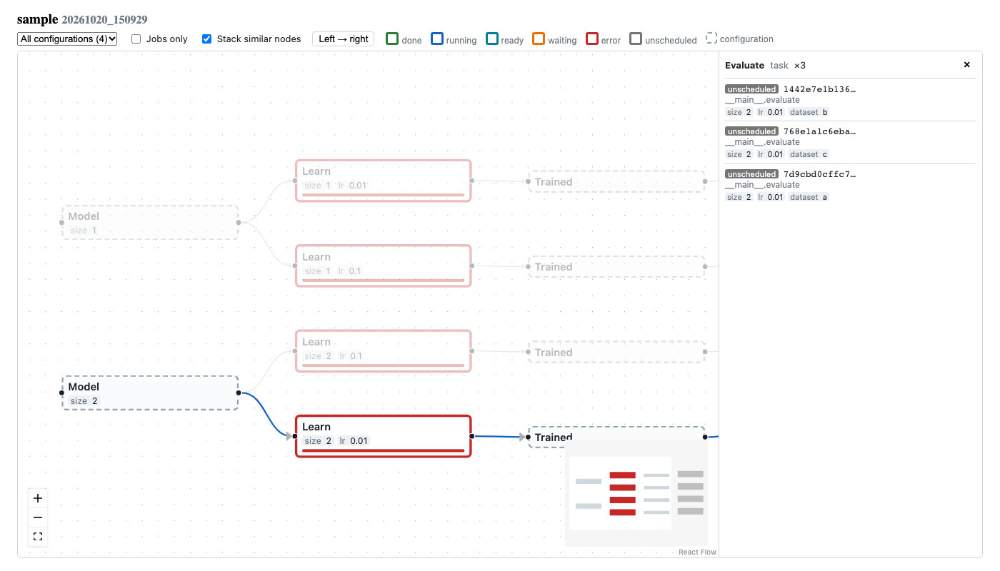

# Command Line Interface

## Overview

```
experimaestro [-w WORKSPACE | --workdir PATH | --ssh HOST:PATH] COMMAND
  run           Run an experiment
  monitor       Monitor the experiments of a workspace (local or SSH)
  experiments   Experiments (alias: xp): list, dag, copy, runs, services, actions, carbon
  jobs          Jobs: list, kill, clean, log, path, recover, inspect, diff
  workspace     Workspaces (alias: ws): list, cleanup, orphans, stray, migrate
  tools         Developer tools: check-documentation, find-launchers,
                install-skill, refactor, deprecated
  launchers, connectors, tokens
                Commands provided by plugins
  version
```

The workspace is selected once, before the command: `-w`/`--workspace` takes
a workspace ID from the [settings](settings.md), `--workdir` a directory and
`--ssh` a directory on a remote host (see [](#remote-workspaces)).
Without either, the default (first) workspace is used — or, for `run`, the
workspace whose triggers match the experiment ID.

```bash
experimaestro -w my-cluster monitor --web
experimaestro --workdir /path/to/workspace jobs list
experimaestro --ssh user@cluster:/scratch/experiments jobs list
```

:::{note}
Commands were reorganized in experimaestro 2.x. The old names
(`run-experiment`, `experiments ssh-monitor`, `experiments history`,
`orphans`, `cleanup`, `dag`, `inspect`, `workspaces`, `migrate`,
`refactor`, …) still work but print a deprecation warning.
`experimaestro run PARAMS.json` (running a single task from its
`params.json`) is also still supported.
:::

(remote-workspaces)=
## Remote (SSH) Workspaces

A workspace is remote when it has [SSH settings](settings.md#remote-workspaces-ssh)
(`experimaestro -w my-cluster …`), or when it is given with `--ssh HOST:PATH`.
All the commands work on a remote workspace, except `run` (experiments are run
on the host of their workspace):

- `monitor`, `experiments list`, `experiments dag`, `experiments services list`
  and `jobs list/kill/clean` read the workspace through a monitoring server
  started on the remote host (JSON-RPC over SSH);
- the other commands are run on the remote host (`experimaestro --workdir PATH
  COMMAND …` over SSH), with their output and prompts shown locally.

When the connection of a monitoring server drops (e.g. `monitor`), it is
re-established automatically, a bounded number of times (see
[reconnection settings](settings.md#reconnection)); the TUI and the web UI
show the connection state.

The remote host needs experimaestro: by default, it is run with `uv tool run`,
with a version compatible with the local one. The SSH options are given before
the command, and override the workspace SSH settings:

| Option | Description |
|--------|-------------|
| `--ssh HOST:PATH` | Remote workspace `PATH` on `HOST` (cannot be used with `--workdir`) |
| `--remote-xpm PATH` | Path to experimaestro on remote host |
| `-o, --ssh-option OPT` | Additional SSH options (can be repeated) |
| `--remote-shell-init CMD` | Shell commands to run before remote experimaestro |
| `--uv-offline` | Pass `--offline` to `uv tool run` (no network) |
| `--remote-python NAME` | Python interpreter for `uv tool run --python` |
| `--force-version` | Run exactly the local experimaestro version (instead of the same minor version) |
| `--request-timeout SECS` | Timeout for remote RPC requests (default: 60) |
| `--connect-timeout SECS` | Time for the remote server to start and answer (default: the `ssh.connect_timeout` setting, or 60) |
| `--remote-logging LEVELS` | Logging levels of the remote server, shown locally (e.g. `xpm.remote.trace=DEBUG`) |

Examples:

```bash
# Using workspace SSH settings from settings.yaml
experimaestro -w my-cluster jobs list --filter '@state = "error"'
experimaestro -w my-cluster experiments runs list my-experiment

# Ad-hoc remote workspace
experimaestro --ssh user@host:/workspace workspace orphans

# With shell init for HPC environments
experimaestro --ssh host:/workspace --remote-shell-init "source /etc/profile; module load python/3.10" jobs list

# Offline mode (no PyPI access)
experimaestro --ssh host:/workspace --uv-offline --remote-python python3 jobs list

# With SSH port and identity file
experimaestro --ssh myserver:/workspace -o "-p 2222" -o "-i ~/.ssh/mykey" experiments list

# With custom experimaestro path on remote
experimaestro --ssh host:/workspace --remote-xpm /path/to/venv/bin/experimaestro jobs log mymodule.MyTask/abc123
```

(running-experiments)=
## Running Experiments

The general command to launch experiments is:

```bash
experimaestro run [OPTIONS] YAML_FILE [ARGS]
```

### run Options

| Option | Description |
|--------|-------------|
| `--run-mode MODE` | Set run mode: `NORMAL`, `DRY_RUN`, `GENERATE_ONLY`, or `PREPARE` |
| `--workspace ID` | Use a workspace from settings by ID (same as `experimaestro -w ID run`) |
| `--workdir PATH` | Specify working directory directly |
| `--port PORT` | Port for web monitoring interface |
| `--console` | Use the terminal (Textual) UI |
| `--web` | Start the web interface |
| `--host HOST` | Server hostname (for remote job access) |
| `--pre-yaml FILE` | Load YAML file before the main one (can be repeated) |
| `--post-yaml FILE` | Load YAML file after the main one (can be repeated) |
| `-c KEY=VALUE` | Override configuration values |
| `--file PATH` | Python file containing the `run` function |
| `--module-name NAME` | Python module containing the `run` function |
| `--env KEY VALUE` | Set environment variable (can be repeated) |
| `--xpm-config-dir PATH` | Custom experimaestro config directory |
| `--show` | Print merged configuration and exit |
| `--debug` | Enable debug logging |

### Run Modes

`experimaestro run --run-mode [DRY_RUN|NORMAL|GENERATE_ONLY|PREPARE]`

- `DRY_RUN` - Display task hashes and dependencies without launching
- `GENERATE_ONLY` - Generate job folders without [launching](./launchers/index.md) tasks
- `NORMAL` - Generate and launch jobs (default)
- `PREPARE` - Run only data-preparation steps (every
  {py:class}`~experimaestro.Prepare` instance referenced by submitted tasks),
  skipping the tasks themselves. Useful for pre-warming caches before
  running jobs on an offline cluster. See [Prepare configurations](./experiments/config.md#prepare-configurations-data-preparation).

## Job Control

Besides the web interface, it is possible to use the command line to check the job
status and control jobs.

### Available Commands

| Command | Description |
|---------|-------------|
| `experimaestro jobs list` | List all jobs in the workspace (sorted by date, most recent first) |
| `experimaestro jobs kill` | Kill running jobs |
| `experimaestro jobs clean` | Clean (delete) finished jobs |
| `experimaestro jobs log JOBID` | View job log (stderr by default) |
| `experimaestro jobs path JOBID` | Print the path to a job directory |
| `experimaestro jobs recover JOBID` | Recover a job from a backup folder |
| `experimaestro jobs inspect [TARGET]` | Inspect job parameters (interactive TUI) |
| `experimaestro jobs diff PATH1 PATH2` | Difference between two job configurations |

### Common Options

The `list`, `kill` and `clean` commands support these options (the workspace
is selected with `experimaestro -w ID jobs …` or `experimaestro --workdir PATH jobs …`):

- `--experiment ID`: Filter by experiment ID
- `--filter EXPR`: Filter using a filter expression (see below)
- `--tags`: Show job tags in output
- `--fullpath`: Show full paths instead of `task.id/hash` format

### List Command Options

The `list` command has additional options:

- `--count N` or `-c N`: Limit output to the N most recent jobs

```bash
# Show only the 10 most recent jobs
experimaestro jobs list -c 10

# Show the 5 most recent running jobs
experimaestro jobs list --filter '@state = "running"' -c 5
```

### Kill and Clean Commands

The `kill` and `clean` commands require `--perform` to actually execute:

```bash
# Dry run - shows what would be killed
experimaestro jobs kill --filter '@state = "running"'

# Actually kill the jobs
experimaestro jobs kill --filter '@state = "running"' --perform
```

```bash
# Dry run - shows what would be cleaned
experimaestro jobs clean --filter '@state = "done"'

# Actually clean the jobs (deletes the job directories)
experimaestro jobs clean --filter '@state = "done"' --perform
```

### Log and Path Commands

The `log` and `path` commands take a JOBID in the format `task.name/hash`:

```bash
# View stderr log (default)
experimaestro jobs log mymodule.MyTask/abc123def

# View stdout log
experimaestro jobs log --std mymodule.MyTask/abc123def

# Follow log (like tail -f)
experimaestro jobs log -f mymodule.MyTask/abc123def

# Get job directory path
experimaestro jobs path mymodule.MyTask/abc123def

# Inspect job parameters in interactive TUI
experimaestro jobs inspect mymodule.MyTask/abc123def
```

## Filter Expressions

The job filter is a boolean expression that allows filtering jobs by state, name, or tags.

### Special Variables

- `@state`: Job state (values: `unscheduled`, `waiting`, `ready`, `scheduled`, `running`, `done`, `error`)
- `@name`: Task identifier (e.g., `mymodule.MyTask`)

### Operators

- `=`: Equality comparison
- `~`: Regex matching
- `in`: Membership in a list
- `not in`: Non-membership in a list
- `and`: Logical AND
- `or`: Logical OR

Values are quoted with `"` or `'` (there is no escape character: a value
containing a `"` is written between `'`). Parentheses are not supported.
In the web UI, the filter input suggests fields, operators, states and the tag
keys and values of the displayed jobs (see
[Job Filter Expressions](interfaces.md#job-filter-expressions)).

### Examples

Filter by state:
```bash
# List only running jobs
experimaestro jobs list --filter '@state = "running"'

# List completed jobs
experimaestro jobs list --filter '@state = "done"'

# List failed jobs
experimaestro jobs list --filter '@state = "error"'
```

Filter by tag:
```bash
# Filter by a single tag
experimaestro jobs list --filter 'model = "bm25"'

# Filter by multiple tags
experimaestro jobs list --filter 'model = "bm25" and dataset = "msmarco"'
```

Complex filters:
```bash
# Running or waiting jobs
experimaestro jobs list --filter '@state = "running" or @state = "waiting"'

# Jobs with model in a list
experimaestro jobs list --filter 'model in ["bm25", "splade"]'

# Jobs NOT matching a value
experimaestro jobs list --filter 'mode not in ["debug", "test"]'

# Combine state and tag filters
experimaestro jobs list --filter '@state = "error" and model = "bm25"'
```

## Tags

Using the `--tags` flag, lists all jobs and shows their tagged arguments:

```bash
experimaestro jobs list --tags
```

Output example:
```
DONE    mymodule.MyTask/abc123 [my_experiment] model=bm25 dataset=msmarco
RUNNING mymodule.MyTask/def456 [my_experiment] model=splade dataset=msmarco
```

### Cleanup Partial Directories

Partial directories are shared checkpoint locations created by `partial()`.
When all jobs using a partial are deleted, the partial becomes orphaned;
`experimaestro workspace cleanup` offers to remove them.

## Experiment Management

The `experiments` command group provides tools for managing experiments:

```bash
experimaestro experiments [OPTIONS] COMMAND
```

### Available Commands

| Command | Description |
|---------|-------------|
| `list` | List experiments in the workspace |
| `dag` | Show the dependency graph of an experiment (see [below](#experiment-dag-visualization-experimaestro-experiments-dag)) |
| `copy` | Copy an experiment between workspaces |
| `runs list` / `runs prune` | History of the runs of an experiment, and pruning |
| `runs tag` / `runs untag` / `runs tags` | Tag runs of an experiment |
| `services list` / `services start` | Inspect and start experiment services |
| `actions list` / `actions run` | Experiment actions (alpha) |
| `carbon summary` / `carbon stats` | Carbon tracking |

### List Command

List experiments with their status and metadata:

```bash
experimaestro --workdir /path/to/workspace experiments list
```

Output format:
```
experiment-id [hostname] (finished_jobs/total_jobs jobs)
```

- `experiment-id`: The experiment identifier
- `hostname`: The host where the experiment was launched (if recorded)
- Job counts: Number of completed jobs out of total

## Monitoring

`experimaestro monitor` launches an interactive monitoring interface for the
experiments of a workspace; choose the interface with `--web` or `--console`
(there is no default):

```bash
# Web interface (default) on port 12345
experimaestro --workdir /path/to/workspace monitor --web

# Console TUI interface
experimaestro --workdir /path/to/workspace monitor --console

# Custom port for web interface
experimaestro --workdir /path/to/workspace monitor --web --port 8080
```

### Remote (SSH) workspaces

A [remote workspace](#remote-workspaces) is monitored through SSH:

```bash
# Using workspace SSH settings from settings.yaml
experimaestro -w my-cluster monitor --web

# Ad-hoc remote workspace, with the console TUI
experimaestro --ssh user@host:/workspace monitor --console
```

See [Remote Monitoring via SSH](interfaces.md#remote-monitoring-via-ssh) for detailed documentation.

### Copy Command

Copy an experiment (run directory and all referenced job directories) between workspaces.
Supports local and remote (SSH) workspaces.

```bash
experimaestro experiments copy [OPTIONS] [EXPERIMENT_ID] [RUN_ID]
```

| Option | Description |
|--------|-------------|
| `--from-workspace ID` | Source workspace ID (from settings.yaml) |
| `--to-workspace ID` | Destination workspace ID |
| `-y, --yes` | Actually perform the copy (default is dry-run) |

When arguments or options are omitted, the command prompts for interactive selection.

**Examples:**

```bash
# Dry-run (default) — shows what would be copied
experimaestro experiments copy --from-workspace cluster --to-workspace local my_experiment

# Actually copy
experimaestro experiments copy --from-workspace cluster --to-workspace local my_experiment -y

# Interactive mode — prompts for everything
experimaestro experiments copy
```

**What gets copied:**

- The experiment run directory (`experiments/<id>/<run_id>/`) — metadata, events, configs
- All job directories referenced in `jobs.jsonl` — outputs, logs, params
- Jobs that already exist at the destination are skipped

**Path encoding:** Since experimaestro 2.4, `params.json` stores paths relative to
the job root or workspace (see [serialization](serialization.md#paths-in-paramsjson)),
so copying a job between workspaces does not require rewriting paths inside the file.
The top-level `"workspace"` field — and any absolute paths produced by older
versions — are still rewritten for backward compatibility.

**Atomic staging:** Each job is first rsynced into a temporary staging directory
(`.xpm-staging/`) inside the destination workspace, then moved to its final location.
This prevents partial copies from leaving broken state.

See also the [Python API](utilities.md#copying-experiments) for programmatic use.

## Workspaces Management

The `workspace` command group (alias: `ws`) lists, cleans up and migrates
workspaces. You can list the workspaces configured in your `settings.yaml`:

```bash
experimaestro workspace list [OPTIONS]
```

```
Options:
  `-v`, `--verbose`  Output all workspace configuration parameters (e.g. ssh, env, folders) |
```

### Cleaning Up

```bash
# Interactive cleanup: orphaned events, stray and orphan jobs, orphan partials
experimaestro workspace cleanup

# Jobs that are not part of any experiment
experimaestro workspace orphans [--size] [--clean] [--no-folders]

# Stray jobs (not associated with any experiment), killing or deleting them
experimaestro workspace stray [--size] [--kill] [--delete] [--perform]
```

### Migrating from experimaestro 1.x

```bash
experimaestro workspace migrate v1-to-v2 [--dry-run] [WORKDIR]
```

## Difference between two configurations

It is possible to look at the differences (that explain that two tasks have a
different identifier) with `experimaestro jobs diff PARAMS1 PARAMS2`, and at
the reason of an identifier change for a job with
`experimaestro tools deprecated diff JOBPATH`.

## Developer Tools

The `tools` command group gathers helpers for developers of
experimaestro-based code: `check-documentation`, `find-launchers`,
`install-skill`, `refactor` and `deprecated`.

## Refactoring Code

### Fix Bare Default Values

The `refactor default-values` command helps migrate from deprecated bare default values
to the explicit `field(ignore_default=...)` syntax:

```bash
# Dry run - shows what would be changed (default)
experimaestro tools refactor default-values /path/to/project

# Actually apply the changes
experimaestro tools refactor default-values /path/to/project --perform
```

This converts patterns like:
```python
x: Param[int] = 23
```

To the explicit form:
```python
x: Param[int] = field(ignore_default=23)
```

The tool:

- Scans Python files for `Param`, `Meta`, or `Option` annotations with bare default values
- Suggests converting to `field(ignore_default=...)` to maintain backwards compatibility
- Runs in dry-run mode by default (use `--perform` to apply changes)
- Handles simple single-line defaults; multi-line defaults require manual intervention

## Installing the Agent Skill

Experimaestro ships an [Agent Skill](https://agentskills.io) that provides LLM
coding assistants (Claude Code, Cursor, Gemini CLI, VS Code Copilot, etc.) with
experimaestro best practices and patterns. The skill teaches the assistant how to
correctly write `Config`/`Task` classes, set up experiments, configure launchers, and
more.

### Install

```bash
# Install to ~/.agents/skills/ (open standard, works with all compatible tools)
experimaestro tools install-skill

# Install for a specific tool
experimaestro tools install-skill claude

# Install to multiple targets at once
experimaestro tools install-skill agents claude cursor
```

### Available targets

| Target | Directory | Description |
|--------|-----------|-------------|
| `agents` | `~/.agents/skills/` | Cross-client open standard (default) |
| `claude` | `~/.claude/skills/` | Claude Code |
| `cursor` | `~/.cursor/skills/` | Cursor |

### List targets and status

```bash
experimaestro tools install-skill --list
```

Shows all targets, which tools are detected on your system, and whether the skill
is already installed.

### Updating

Run the same `tools install-skill` command again after upgrading experimaestro to update
the skill to the latest version.

## (Sphinx) Checking undocumented configurations

Use `experimaestro tools check-documentation objects.inv my_package` to check for undocumented members. The `objects.inv` file should be generated by sphinx

## Experiment DAG Visualization (`experimaestro experiments dag`)

The `dag` command shows the dependency graph of an experiment run: its tasks,
actions and (optionally) the configurations that link them. It is the same
view as the *Graph* tab of the [web UI](interfaces.md#experiment-dag-visualization),
exported as a standalone HTML page that needs no server.



- Nodes are coloured by job status; clicking a node highlights its ancestors
  and descendants and shows its details
- Structurally equivalent nodes (e.g. the same evaluation run on many
  datasets) are stacked into one
- Configurations (e.g. a trained model, output of a task and input of another)
  can be shown or hidden
- Wired with the [Grid Search](experiments/grid_search.md) feature: the graph
  can be restricted to one configuration of the grid

The graph is read from the run records (`objects.jsonl`), without importing
the experiment code, and works with remote (SSH) workspaces.

```bash
# Open the graph in the browser (default)
experimaestro experiments dag my_experiment

# Save a standalone HTML page
experimaestro experiments dag my_experiment --html dag.html

# List the grid search configurations, and print one stage by stage
experimaestro experiments dag my_experiment --list-configs
experimaestro experiments dag my_experiment --tree -c 0
experimaestro experiments dag my_experiment --tree --filter "lr=0.001,kernel_size=3"

# Dump the graph and all its views as JSON
experimaestro experiments dag my_experiment --json -
```

### Options

| Option | Description |
|--------|-------------|
| `EXPERIMENT_ID` | Experiment identifier (prompted for if not given) |
| `-r, --run` | Run ID (default: current run) |
| `-w, --workspace` | Workspace ID or directory (default: `experimaestro -w`, or from the settings) |
| `--html PATH` | Save the graph as a standalone HTML page |
| `--json PATH` | Save the graph and its views as JSON (`-` for the standard output) |
| `-t, --tree` | Print the graph, stage by stage |
| `--list-configs` | List the grid search configurations |
| `-c, --config` | With `--tree`, restrict to a configuration (see `--list-configs`) |
| `--filter` | With `--tree`, restrict to the nodes with these tags (e.g. `lr=0.001,seed=1`) |
| `--all-nodes` | With `--tree`, also show configurations (not only jobs) |
| `--stack / --no-stack` | With `--tree`, stack similar nodes (default: stacked) |

## Job Parameters Inspector (`experimaestro jobs inspect`)

Experimaestro provides an interactive terminal-based (TUI) parameters inspector built with Textual. It visualizes the hierarchical configuration graph of jobs, with support for cycle detection, relative path resolution, Python code synthesis, and remote workspace job inspection via SSH.

```bash
# Inspect current directory / job
experimaestro jobs inspect

# Inspect a specific job by task name or hash prefix
experimaestro jobs inspect mymodule.MyTask/1822b2b

# Inspect a specific params.json directly
experimaestro jobs inspect /path/to/params.json

# Inspect a job in a remote SSH workspace
experimaestro jobs inspect -w my_cluster mymodule.MyTask/1822b2b
```

### Options

| Option | Description |
|--------|-------------|
| `TARGET` | Job ID or hash prefix, path to `params.json` / `experimaestro.json`, or job directory (default: `.`) |
| `-w, --workspace` | Workspace ID or directory path (defaults to current Experimaestro workspace; supports remote SSH workspaces) |

### Keybindings

| Key | Action |
|-----|--------|
| `q` / `Esc` | Quit / close active search or modal |
| `/` | Focus search bar to filter nodes by parameter name or value |
| `g` | Toggle parameter grouping (alphabetical vs categorized) |
| `p` | Toggle path display (relative vs absolute) |
| `c` | Copy synthesized Python code snippet to clipboard |
| `s` | Copy selected parameter value or resolved path to clipboard |
| `J` | Toggle raw JSON view |
| `e` | Expand all nodes |
| `c` (on parent) | Collapse all child nodes |
| `?` | Show interactive keyboard shortcuts and help |
